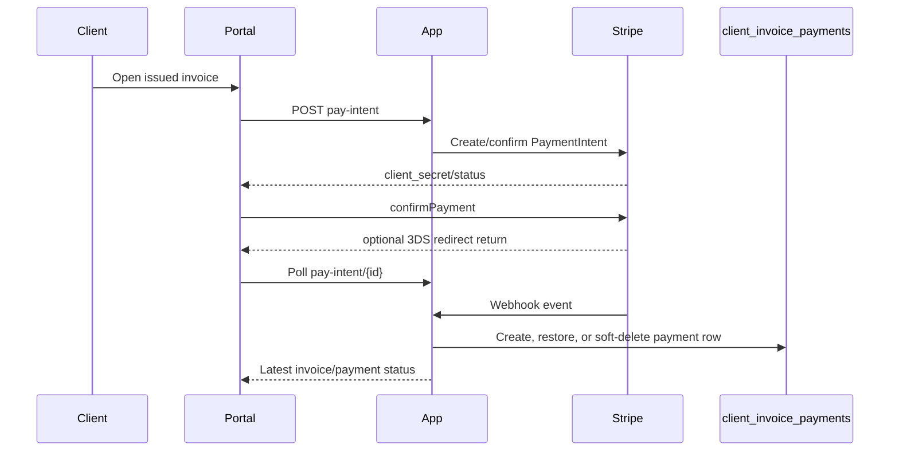

# Stripe Billing

Client invoices can be paid online through Stripe when the invoice is issued, has a remaining balance, and the invoice total is at or below the configured cap. The default cap is `100000` cents ($1,000) in `config/client-management.php`; larger invoices remain manual-only.

## Configuration

Set these environment values before enabling online payments:

```env
STRIPE_PUBLISHABLE_KEY=pk_test_...
STRIPE_SECRET_KEY=sk_test_...
STRIPE_WEBHOOK_SECRET=whsec_...
STRIPE_FINANCIAL_CONNECTIONS_ENABLED=false
```

Financial Connections is feature-gated and defaults off. The day-one flow still supports `us_bank_account`; enabling the flag lets Stripe collect bank-account credentials through Financial Connections permissions.

## High-Level Flow



`client_invoice_payments` remains the invoice payment ledger. Stripe-specific tables store customer IDs, saved method metadata, PaymentIntent activity, and webhook idempotency records. `stripe_payment_method_states` is the adapter-owned routing index for payment-method webhooks: it stores a one-way provider-ID hash, the resolved tenant IDs when known, and the newest attach/detach occurrence. It contains no card data or provider payload.

## Client Portal

- `/client/portal/{slug}/billing` shows saved payment methods for the client company.
- Issued invoice pages show a payment panel for online-eligible invoices.
- Clients can pay with a saved method, a new card, a US bank account, or choose manual instructions.
- Saving a new method is explicit opt-in.
- 3DS and other redirect confirmations return to the invoice page, which polls `pay-intent/{id}` until the payment leaves `requires_action`.
- Failed online payment attempts are surfaced on the invoice payment panel.
- Saved methods are scoped to a client company and can be removed or marked default.

## Admin Surfaces

- Invoice detail shows Stripe activity, status, amount, failure reason, and the last Stripe event or poll marker.
- Issued invoice detail includes a copy-to-clipboard pay-link button for resending payment links manually.
- Invoice list filters include Stripe failures, using the latest failed or canceled Stripe payment for each invoice.

## Supported Events

Subscribe the Stripe webhook endpoint to these event types:

- `payment_intent.succeeded`: creates or restores a `ClientInvoicePayment`, then marks the invoice paid when the ledger covers the total.
- `payment_intent.processing`: records pending ACH/card state without marking the invoice paid.
- `payment_intent.payment_failed`: records `failure_reason` and logs `invoice.payment_failed`.
- `payment_intent.canceled`: records a distinct terminal canceled state and logs `invoice.payment_canceled`; an older processing/failure delivery cannot make it pending again.
- `charge.refunded`: records the charge's cumulative refunded amount on the payment - `refunded` when it is the whole payment, `succeeded` with the refunded amount raised otherwise - and reopens the invoice by that amount.
- `refund.failed` **and** `refund.updated` (required for refund reversals; `charge.refund.updated` is the older name of `refund.updated` and may stand in for it): an asynchronous refund failure is sent only as `refund.failed`, and a canceled refund as an update. When a refund failed or was canceled, svc re-reads the charge's refunds from Stripe and records the total of those still standing, so the refunded amount falls again, recorded as `invoice.payment_refund_reversed` ("Refund reversed") rather than another refund. The total is applied even when the notification arrives after a newer event for the payment. If the payment changed while Stripe was being read - a newer refund recorded meanwhile - nothing is applied and the endpoint answers 503, so Stripe's retry reads afresh. Other refund updates change nothing.
- `charge.dispute.created`: marks the payment disputed and holds back only the disputed amount (`disputed_amount`), so a partial dispute reopens the invoice by that amount; without an amount the whole payment is held.
- `charge.dispute.closed`: restores the payment when the dispute is won, including a partial win (the disputed amount is checked against the payment, not required to equal it); keeps it disputed when lost. A win after the invoice was paid again in the meantime is still recorded; the excess becomes the invoice's overpayment (derived credit) and is named as `overpaid_amount` in the `invoice.payment_received` activity. A win after the invoice was voided restores the payment and leaves the invoice void, with `review: restored_on_void_invoice` in that activity.

Refunds and disputes are recorded whatever the payment's finance reconciliation allocations; they are kept and flagged for review (see [the finance reconciliation API](../finance-api.md)).

- `payout.paid`, `payout.failed` and `payout.canceled`: store the payout for each workspace whose payments its balance transactions name, and record on each charged payment its payout, arrival date and fee (see [processor settlement and payouts](../finance-api.md#processor-settlement-and-payouts)). An automatic payout's balance transactions are read from Stripe; while Stripe cannot be read the endpoint answers 503 and Stripe's retry applies the event. A report older than the one stored changes nothing, so a payout reported failed after it was paid stays failed. A succeeded payment's charge time and fee are read after `payment_intent.succeeded`, best effort; `svc:finance:backfill-payouts` fills history.

- `payment_method.attached`: syncs saved method metadata for the Stripe customer.
- `payment_method.detached`: soft-deletes the saved method locally after resolving its tenant through the adapter index. An out-of-order detach creates a tombstone, so an older attach cannot resurrect an unusable method.
- `setup_intent.succeeded`: syncs the saved method and records `payment_method.added`.

Duplicate events are ignored using the unique `client_stripe_events.stripe_event_id` record. Events for Stripe customers that have no SVC mapping are acknowledged as permanently irrelevant; there is no webhook path that can create that ownership mapping. A known customer whose referenced default method has not arrived yet remains transient and is retried. Deterministic domain mismatches are recorded as failed and acknowledged on exact replay.

## Stripe CLI Quickstart

Use the Stripe CLI for local webhook testing:

```bash
stripe login
stripe listen --forward-to http://127.0.0.1:8000/api/webhooks/stripe
```

Copy the printed `whsec_...` value into `STRIPE_WEBHOOK_SECRET`. Trigger smoke-test events with:

```bash
stripe trigger payment_intent.succeeded
stripe trigger payment_intent.payment_failed
stripe trigger charge.refunded
```

For invoice-specific tests, create the PaymentIntent through the portal so metadata includes `client_invoice_id` and `client_company_id`, then complete or refund it from the Stripe Dashboard or CLI.

## Replay Guidance

Webhook bodies are deliberately not stored. `client_stripe_events` retains the Stripe event ID, type, object ID, payload hash, status, and a bounded error summary. To replay an event safely:

1. Confirm the event row is still `received`, or investigate a `failed` row before deciding that reprocessing is intentional.
2. Resend the original event from the Stripe Dashboard or CLI; do not reconstruct it from database material because the raw body is not retained.
3. Exact repeats of a `processed` or `failed` event ID are intentionally acknowledged as duplicates. An operator-approved replay therefore needs a new Stripe delivery/event identity or a deliberate repair workflow.
4. Verify `processed_at`, the corresponding invoice/payment-method state, and the single matching company-activity event.

For one-off local debugging, prefer replaying through Stripe instead of manually editing ledger rows; the webhook path is the behavior under test.
