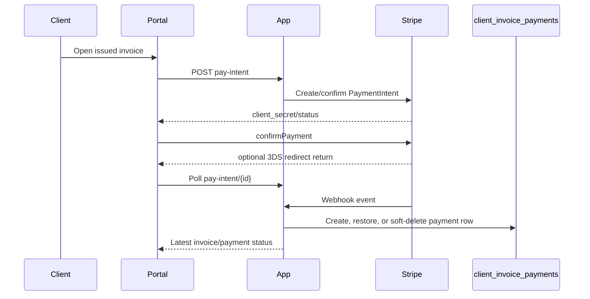
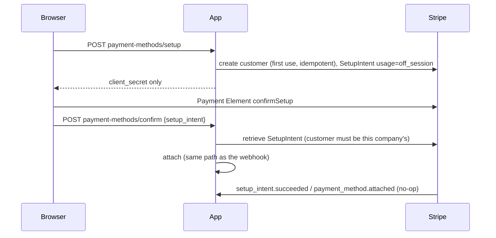
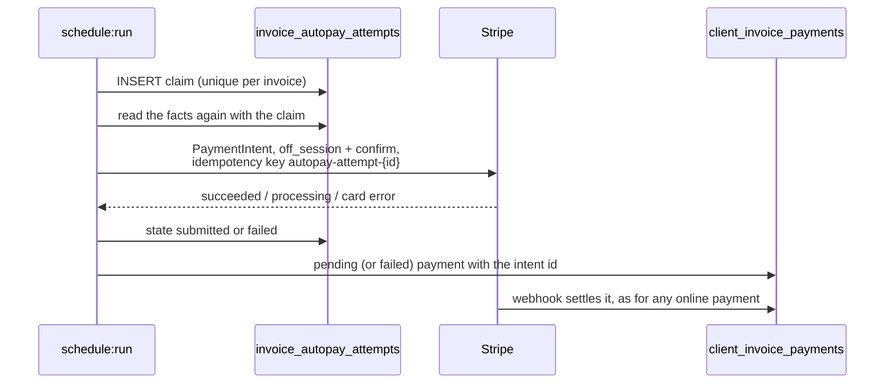

# Stripe Billing

Client invoices can be paid online through Stripe when the invoice is issued, has a remaining balance, and the invoice total is at or below the configured cap. The default cap is `100000` cents ($1,000) in `config/client-management.php`; larger invoices remain manual-only.

## Configuration

Set these environment values before enabling online payments:

```env
STRIPE_PUBLISHABLE_KEY=pk_test_...
STRIPE_SECRET_KEY=sk_test_...
STRIPE_WEBHOOK_SECRET=whsec_...
STRIPE_FINANCIAL_CONNECTIONS_ENABLED=false
```

Financial Connections is feature-gated and defaults off. The day-one flow still supports `us_bank_account`; enabling the flag lets Stripe collect bank-account credentials through Financial Connections permissions.

## High-Level Flow



`client_invoice_payments` remains the invoice payment ledger. Stripe-specific tables store customer IDs, saved method metadata, PaymentIntent activity, and webhook idempotency records. `stripe_payment_method_states` is the adapter-owned routing index for payment-method webhooks: it stores a one-way provider-ID hash, the resolved tenant IDs when known, and the newest attach/detach occurrence. It contains no card data or provider payload.

## Client Portal

- `/client/portal/{slug}/billing` shows saved payment methods for the client company.
- Issued invoice pages show a payment panel for online-eligible invoices.
- Clients can pay with a saved method, a new card, a US bank account, or choose manual instructions.
- Saving a new method is explicit opt-in.
- 3DS and other redirect confirmations return to the invoice page, which polls `pay-intent/{id}` until the payment leaves `requires_action`.
- Failed online payment attempts are surfaced on the invoice payment panel.
- Saved methods are scoped to a client company. A contact with company-wide portal access can add a card or US bank account on the Billing page (see below), mark one default, or remove one.

### Managing saved methods in the portal

`/portal/{company}/billing` is where a client keeps the methods autopay charges. Who may: the contacts who may consent to autopay (`PortalAutopayAuthority`); the server sends finished URLs or null. All Stripe calls use the workspace's own connection, are made outside database transactions, and are recorded locally afterwards through `StripePaymentMethodService`, the service the webhook uses, so the webhook for the same change is a no-op.



- **Add**: only when the workspace's Stripe connection and publishable key are known (the portal pay path's check). The first saved method becomes the default.
- **Make default**: `customers.update(invoice_settings.default_payment_method)`, then the local flag, exactly one per company; the `customer.updated` webhook converges on the same state.
- **Remove**: `payment_methods.detach`, then the local soft delete. Removing the default turns autopay off after commit, as the webhook path does.

## Admin Surfaces

- Invoice detail shows Stripe activity, status, amount, failure reason, and the last Stripe event or poll marker.
- Issued invoice detail includes a copy-to-clipboard pay-link button for resending payment links manually.
- Invoice list filters include Stripe failures, using the latest failed or canceled Stripe payment for each invoice.

## Autopay

Autopay (#636) lets SVC charge a client company's default saved Stripe payment
method for an issued invoice on its due date. It is not Stripe Billing: SVC owns
the invoice, its cadence and its corrections, and the saved method is only the
rail. Square is unchanged.

### Turning it on and off

- **The client**, in the portal Billing page (`/portal/{company}/billing`): a
  contact with company-wide access chooses a per-invoice limit and ticks an
  authorization whose exact wording (method, company, limit) is stored.
- **The provider**: an owner or admin, in the client's settings or through
  `companies.autopay.set`, enters the limit and a free-text attestation of how the
  client agreed outside SVC. The client's billing contacts are emailed a notice
  with a link to the portal Billing page to turn it off, after the change commits.
- **Either side** can turn it off or change the limit. Every on, off and limit
  change appends a row to `client_autopay_consents` (who, role, when, limit,
  method, wording or attestation). Rows are never edited or deleted.
- Removing the default payment method turns autopay off, recorded as SVC's.

### What gets charged

`svc:billing:charge-autopay --apply --limit=50` runs every fifteen minutes from the
scheduler. There is no queue worker. Without `--apply` it prints what it would charge.
An invoice is charged when `AutopayEligibility` says so, a pure, database-free
decision: issued or partially paid with a balance, visible to the client, due on or
before today in the workspace's time zone and not before autopay was turned on,
autopay on, a default method, no payment already moving, not collected by Square,
Stripe connected, the invoice's currency the limit's, no prior attempt (a skip is
one), and the balance at or under the limit. A balance exactly at the limit is
charged. Over the limit is not charged, and both sides see "Not autopaid: over
limit" before the due date. The limit replaces the online-payment cap for autopay only.

### One attempt, claimed first



`(workspace_id, client_invoice_id)` is unique, so repeated or concurrent runs claim an
invoice once. The claim is committed before Stripe is called and the call is outside
every transaction. If the facts changed after the claim, the claim is deleted and
nothing was sent. If Stripe's answer cannot be read, the attempt stays `claimed`
with no PaymentIntent: it is listed by every run for review and never retried.
A declined card or an authentication request is one failed attempt: the reason is on
the attempt, a `failed` payment appears in the invoice's payments, and the invoice
returns to the ordinary payment reminders. There are no retries.

### When Stripe refuses our connection

An `AuthenticationException`, a `PermissionException`, or an `InvalidRequestException`
whose code names the key or account (`api_key_expired`, `account_invalid`,
`platform_account_required`, `secret_key_required`, `livemode_mismatch`,
`testmode_charges_only`; see `AutopayConnectionRefusal`) is about the provider's
connection, not the client's card. Nothing was charged, so the claim is deleted and no
attempt is recorded: the client sees nothing and the invoice is charged by the first run
after the connection is fixed. Every other `InvalidRequestException` (a deleted customer,
a bad parameter) stays a failed attempt.

The workspace is marked in `workspaces.stripe_refused_at`. The provider is told by an
`invoice.autopay_connection_refused` activity on the invoice (once per breakage), by
`connection_problem` on `companies.autopay.get` / `invoices.autopay.get` (shown as "Not
charged yet: the Stripe connection needs attention" with a link to the workspace payments
settings on the client's Autopay card and the invoice's Autopay card), and by the command
(`connection_needs_attention` in JSON, a warning in text). While the marker is under six
hours old (`StripeConnectionHealth::BACKOFF_HOURS`) the command does not call Stripe for
that workspace and the workspace's invoices do not use up the run's `--limit`. The marker
ends when the connection is saved again (a `connected_at` after it) or when Stripe next
answers an ordinary call (a charge, a decline, a different request error); the warning
stays until then, past the six hours, when the next run tries once more.

### Closing out a held attempt

An attempt left `claimed` with no PaymentIntent (Stripe's answer was never read) is listed
by every run. Ten minutes after the claim an owner or admin can close it out from the
invoice's Autopay card, `invoices.autopay.resolve` over REST, or the MCP tool of the same
name (explicit confirmation required), after checking the Stripe dashboard:

- **Charged**, with the PaymentIntent id. SVC reads the intent from Stripe (outside any
  transaction) and refuses it unless its metadata names this workspace and invoice (and
  this attempt, when it names one), its amount and currency equal the attempt's, and
  Stripe says `succeeded` or `processing`. It enters the ledger as the charge path does
  (succeeded or pending), the attempt becomes `submitted`, and the webhook settles it.
- **Not charged**, with a note. The attempt becomes `not_charged`; the invoice is left for
  manual collection and no new attempt is made.

Both are one conditional update on state `claimed` with no PaymentIntent, so of two people
racing one wins and the other gets 409. Who, when and the note are on the attempt and in an
`invoice.autopay_resolved` activity. The action creates and confirms nothing at Stripe.

### Where it shows

The issued invoice (PDF, portal, email) says "Will be charged to Visa ending 4242 on
2030-12-01." when autopay will apply. The portal invoice shows scheduled, failed and
over-limit states; the operator invoice shows the attempt and has **Skip autopay for
this invoice** (who and when are recorded). The client's settings show the state, the
consent record and the next charges. `companies.autopay.get` and `invoices.autopay.get`
read the same over REST and MCP.

## Supported Events

SVC creates the workspace's webhook endpoint itself when a restricted key is saved, and then keeps an eye on it (see [Webhook health](#webhook-health)). The list below is the one in `StripeWebhookService::REQUIRED_EVENTS`; the code is the source of truth and a test fails if a handled event is not listed there. Subscribe a hand-made endpoint to these event types:

- `payment_intent.succeeded`: creates or restores a `ClientInvoicePayment`, then marks the invoice paid when the ledger covers the total.
- `payment_intent.processing`: records pending ACH/card state without marking the invoice paid.
- `payment_intent.payment_failed`: records `failure_reason` and logs `invoice.payment_failed`.
- `payment_intent.canceled`: records a distinct terminal canceled state and logs `invoice.payment_canceled`; an older processing/failure delivery cannot make it pending again.
- `charge.refunded`: re-reads the charge's complete refund list and totals refunds still standing (neither failed nor canceled), then corrects the payment and invoice. It does not trust the notification's `amount_refunded`: [Stripe documents failed refunds returning money](https://docs.stripe.com/refunds#handle-failed-refunds), but does not promise that a later charge aggregate excludes them. The [refund listing](https://docs.stripe.com/api/refunds/list) is authoritative. This current total applies even for an older notification, without rewinding the payment's latest event timestamp. A local payment change during the read, or a failed provider read, returns 503 and keeps the event retryable; no correction from that read is applied.
- `refund.failed` **and** `refund.updated` (both required for refund reversals; `charge.refund.updated` is the older name of `refund.updated`, is still processed if it arrives, and does not count in place of `refund.updated` in the webhook health check): an asynchronous refund failure is sent only as `refund.failed`, and a canceled refund as an update. When a refund failed or was canceled, svc re-reads the charge's refunds from Stripe and records the total of those still standing, so the refunded amount falls again, recorded as `invoice.payment_refund_reversed` ("Refund reversed") rather than another refund. The total is applied even when the notification arrives after a newer event for the payment. If the payment changed while Stripe was being read - a newer refund recorded meanwhile - nothing is applied and the endpoint answers 503, so Stripe's retry reads afresh. Other refund updates change nothing.
- `charge.dispute.created`: marks the payment disputed and holds back only the disputed amount (`disputed_amount`), so a partial dispute reopens the invoice by that amount; without an amount the whole payment is held.
- `charge.dispute.closed`: restores the payment when the dispute is won, including a partial win (the disputed amount is checked against the payment, not required to equal it); keeps it disputed when lost. A win after the invoice was paid again in the meantime is still recorded; the excess becomes the invoice's overpayment (derived credit) and is named as `overpaid_amount` in the `invoice.payment_received` activity. A win after the invoice was voided restores the payment and leaves the invoice void, with `review: restored_on_void_invoice` in that activity.

Refunds and disputes are recorded whatever the payment's finance reconciliation allocations; they are kept and flagged for review (see [the finance reconciliation API](../finance-api.md)).

- `payout.paid`, `payout.failed` and `payout.canceled`: store the payout for each workspace whose payments its balance transactions name, and record on each charged payment its payout, arrival date and fee (see [processor settlement and payouts](../finance-api.md#processor-settlement-and-payouts)). An automatic payout's balance transactions are read from Stripe; while Stripe cannot be read the endpoint answers 503 and Stripe's retry applies the event. A report older than the one stored changes nothing, so a payout reported failed after it was paid stays failed. A succeeded payment's charge time and fee are read after `payment_intent.succeeded`, best effort; `svc:finance:backfill-payouts` fills history.

- `payment_method.attached`: syncs saved method metadata for the Stripe customer.
- `payment_method.detached`: soft-deletes the saved method locally after resolving its tenant through the adapter index. An out-of-order detach creates a tombstone, so an older attach cannot resurrect an unusable method.
- `setup_intent.succeeded`: syncs the saved method and records `payment_method.added`.

Duplicate events are ignored using the unique `client_stripe_events.stripe_event_id` record. Events for Stripe customers that have no SVC mapping are acknowledged as permanently irrelevant; there is no webhook path that can create that ownership mapping. A known customer whose referenced default method has not arrived yet remains transient and is retried. Deterministic domain mismatches are recorded as failed and acknowledged on exact replay.

Three more dispute events are handled and required, though the list above names only two: `charge.dispute.updated`, `charge.dispute.funds_withdrawn` and `charge.dispute.funds_reinstated` are hints to re-read the dispute group. `charge.refund.updated` (the older name of `refund.updated`) is handled and subscribed by the endpoint SVC creates, but is not required, and a subscription to it alone does not satisfy the requirement for `refund.updated`.

## Webhook health

The Payments page (`workspaces.payments`) tells an owner whether Stripe is actually sending SVC everything it needs, so nobody checks the Dashboard by hand.

- **What is checked.** With the connection's own restricted key SVC lists the account's webhook endpoints, judges only the endpoint SVC created for the connection (the stored `webhook_endpoint_id`), because only it signs with the stored signing secret. The URL is this connection's (`/api/webhooks/stripe/{token}`; the environment-made connection also `/api/webhooks/stripe`; scheme, host, port and path compared, case, trailing slash and query ignored). It reports: **endpoint missing** (the stored endpoint no longer exists at Stripe, even when another endpoint has the same URL: that one signs with another secret, so it is never adopted), **endpoint not confirmed** (the connection records no endpoint id, as for a connection migrated from environment configuration, so a URL match proves nothing), not found (the stored endpoint is not at SVC's URL, or nothing is and no id is recorded), disabled, in the other mode (test or live) than the key, missing events (`*` covers everything), or healthy. A key that cannot read webhook endpoints is its own result naming the permission. If Stripe cannot be reached the result is "could not be checked", not a webhook problem.
- **When.** After a key is saved (the save never waits on or fails because of it), when an owner or admin presses **Check again**, and daily at 03:35 UTC from the scheduler: `svc:payments:check-stripe-webhooks --apply` (a preview without `--apply` calls nothing; `--workspace=<public id>`, `--limit=`; connections are checked never-checked first, then oldest check first, then by id, so a bounded run never starves the same workspaces). There is no queue. The result is stored on the connection (`webhook_check_status`, `webhook_check_missing`, `webhook_checked_at`) and the page shows it without calling Stripe.
- **Show.** The Stripe card says "Webhook: all N events subscribed" or "Missing: payment_method.attached, ..." with when it was checked; a warning banner appears for missing events, a disabled or absent endpoint, or the wrong mode. Owners and admins also see the endpoint URL.
- **Fix** (owner or admin, after a confirmation dialog). **Add missing events** sets the endpoint's `enabled_events` to the union of what it has and what it lacks: nothing is removed and no other endpoint is touched. **Reconnect webhook** (offered only for *endpoint missing* and *endpoint not confirmed*) creates a new endpoint at the connection's URL and stores its id and its signing secret together in one save; neither is ever stored without the other, and no other endpoint is touched or adopted, so an old endpoint stays in Stripe for the owner to delete. **Add missing events** is never offered for an endpoint that is not the stored one. **Create endpoint** (offered only when nothing is at SVC's URL and no endpoint id is recorded) creates one with the events SVC handles; Stripe returns a new signing secret, which SVC stores encrypted on the connection in place of the old one (the same storage as every other secret) before saying "Created the Stripe webhook endpoint and stored its signing secret." If the secret cannot be stored the new endpoint is deleted again. A disabled endpoint is not re-enabled by SVC: enable it in the Dashboard.
- **Reused connections** have no health of their own; the workspace that holds the key shows and fixes it.
- **Restricted key permissions.** Read: *Webhook Endpoints: Read*. Fix, and creating the endpoint when the key is saved: *Webhook Endpoints: Write*. Verifying a publishable key: *SetupIntents: Write*.

## Stripe CLI Quickstart

Use the Stripe CLI for local webhook testing:

```bash
stripe login
stripe listen --forward-to http://127.0.0.1:8000/api/webhooks/stripe
```

Copy the printed `whsec_...` value into `STRIPE_WEBHOOK_SECRET`. Trigger smoke-test events with:

```bash
stripe trigger payment_intent.succeeded
stripe trigger payment_intent.payment_failed
stripe trigger charge.refunded
```

For invoice-specific tests, create the PaymentIntent through the portal so metadata includes `client_invoice_id` and `client_company_id`, then complete or refund it from the Stripe Dashboard or CLI.

## Testing against Stripe test mode

`tests/StripeLive/` drives SVC's real code against Stripe's real API in test mode, so
payment changes can be iterated on without paying anything by hand. It is its own PHPUnit
configuration and is not part of the default suites, the CI shards or Infection.

```bash
STRIPE_TEST_SECRET_KEY=rk_test_... php artisan test --configuration=phpunit.stripe-live.xml --testsuite=StripeLive
```

- The suite **skips** when `STRIPE_TEST_SECRET_KEY` is not set, so forks and local runs
  pass. It **refuses to run** (fails, without printing the key) for any key that does not
  start with `sk_test_` or `rk_test_`. A live key is never accepted.
- Restricted key permissions (Write unless noted): **Customers**, **SetupIntents**,
  **PaymentIntents**, **PaymentMethods**, and **Events: Read**. Nothing else is needed.
- Scenarios, each with a fresh synthetic customer (`example.test` address, metadata
  `svc_e2e=1` and a run id): saving a card through the portal SetupIntent path (confirmed
  server-side with `pm_card_visa`), an autopay charge, a declined card (one failed attempt,
  never retried), a card that needs authentication, and removing the default method (autopay
  turns off). Customers are deleted afterwards, best effort.
- **Webhooks need no public URL.** After each scenario the suite lists the resulting events
  from Stripe's Events API (waiting up to 30 seconds for it to catch up), then POSTs each to
  `/api/webhooks/stripe` signed with a secret generated for the run
  (`Stripe-Signature: t=...,v1=HMAC-SHA256("t.payload")`), so the real `StripeWebhookService`
  settles the invoice through the ordinary ledger.
- The Stripe calls use the key through the deployment-environment connection, so no webhook
  endpoint is registered at Stripe and nothing is saved in a real database (the suite uses the
  disposable in-memory one).
- In CI, `.github/workflows/stripe-test-mode.yml` runs it with the repository secret
  `STRIPE_TEST_SECRET_KEY` on billing-path pull requests, pushes to `main` and nightly. It is
  advisory (not part of the required `ci` check) and succeeds with a notice when the secret
  is unavailable.

**Database safety.** The suite refreshes its database (`migrate:fresh`), so it only runs on SQLite in memory: `phpunit.stripe-live.xml` forces every environment value it sets, and the suite refuses to start if the connection it actually resolved is anything else, or if configuration is cached (`php artisan config:clear` first). Nothing is dropped when it refuses.

**Waiting for events.** A scenario waits for its events by predicate, not by type: setup tags the customer before the default is set, so there are two `customer.updated` events, and the wait is for the one whose `invoice_settings.default_payment_method` is the expected method (`StripeExpectation::customerDefault`).

**Webhook replay.** Each scenario's events, including `customer.updated`, are delivered in order to the real route, then all again as duplicates (each must be acknowledged as a duplicate and change nothing). Ordering is its own scenario: SVC's saved methods, method states, receipt ledger and payment-method activity are cleared, then the events are delivered newest first, and in a fixed shuffle, as the first delivery (an event that cannot be applied yet, answered `503`, is delivered again after the rest, as Stripe would), and SVC must end holding the methods and the default Stripe holds. One scenario runs through a saved per-workspace connection instead of the environment key (the row is written directly, the environment credentials are removed, events go to the connection's own endpoint). This is local handler integration. Not covered here: the portal's card form and 3-D Secure return (a browser test), delivery from Stripe to a deployed endpoint and its signing secret, the deployed scheduler, and saving a connection through the settings page (which registers a webhook endpoint at Stripe).

**CI.** Add the repository secret `STRIPE_TEST_SECRET_KEY` (a restricted key from a dedicated Stripe sandbox for CI), then set the repository variable `STRIPE_TEST_SUITE_ENABLED=true`. After that, a push to main, the nightly run or a manual run without the key fails instead of skipping; pull requests from forks still skip. No SSH key is needed: the MCP bridge dependency is public.

## Replay Guidance

Webhook bodies are deliberately not stored. `client_stripe_events` retains the Stripe event ID, type, object ID, payload hash, status, and a bounded error summary. To replay an event safely:

1. Confirm the event row is still `received`, or investigate a `failed` row before deciding that reprocessing is intentional.
2. Resend the original event from the Stripe Dashboard or CLI; do not reconstruct it from database material because the raw body is not retained.
3. Exact repeats of a `processed` or `failed` event ID are intentionally acknowledged as duplicates. An operator-approved replay therefore needs a new Stripe delivery/event identity or a deliberate repair workflow.
4. Verify `processed_at`, the corresponding invoice/payment-method state, and the single matching company-activity event.

For one-off local debugging, prefer replaying through Stripe instead of manually editing ledger rows; the webhook path is the behavior under test.
